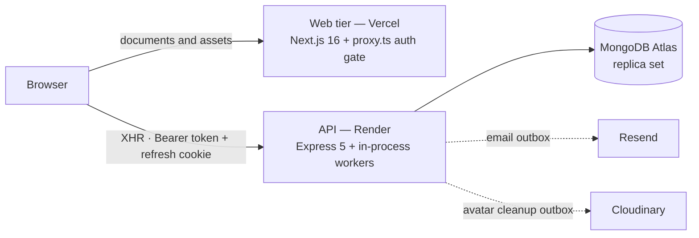
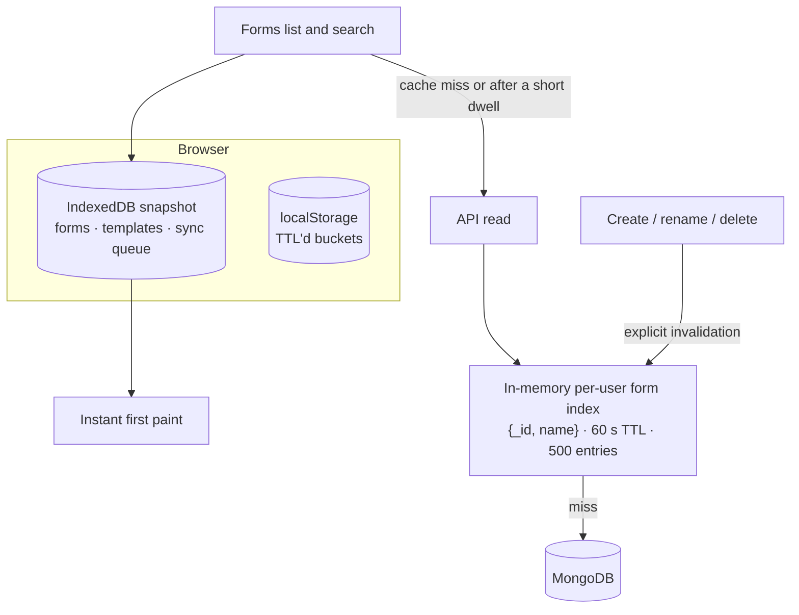
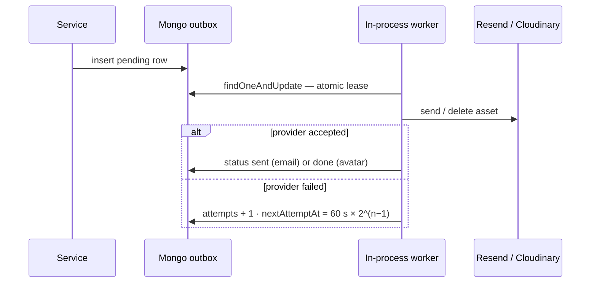

# Paperwork

> Schema-driven form and workflow platform built for modern teams.

Define a form once as a schema, and let the platform render it, validate it, and route submissions through a workflow.

---

## Why?

Internal forms and approval flows — leave requests, onboarding, purchase approvals — are usually hand-coded one at a time: a new UI, new validation, new routing logic, every time. Changing a single field means a code change and a deploy.

Paperwork treats the form as **data**. A schema describes the fields, rules and branching; the platform renders it, validates it, stores responses, and moves respondents through sections based on their answers.

---

## Architecture



The browser talks to the API directly. Vercel only serves the Next.js app and runs the edge auth gate: `proxy.ts` verifies the refresh cookie before a protected page is rendered, so an unauthenticated visitor never sees one.

**Repository layout**

```
paperwork/
├── apps/
│   ├── web/               # Next.js web client (@paperwork/web)
│   │   └── src/
│   │       ├── api/       # axios client, endpoint table, session gate
│   │       ├── features/  # auth, forms (editor, fill, offline sync), settings
│   │       ├── lib/       # Dexie databases, client-cache invalidation
│   │       └── proxy.ts   # edge auth gate (refresh-cookie verification)
│   └── server/            # Express API server (@paperwork/server)
│       ├── docs/          # per-module API notes
│       └── src/
│           ├── cache/     # in-memory per-user form index
│           ├── config/    # env config, CORS, cookies, rate-limit presets
│           ├── db/        # Mongo connection
│           ├── middleware/# requestId, httpLogger, securityAudit, protect, limiter, validate
│           ├── modules/   # auth, forms, email (outbox), signatures (Cloudinary)
│           ├── router/    # /api/v1 mount and JSON 404
│           ├── utils/     # logger, mail, sanitiser, request metadata
│           └── server.ts  # boot: DB, outbox workers, graceful shutdown
├── packages/              # Shared internal packages
├── pnpm-workspace.yaml    # Workspace configuration
└── docker-compose.yml     # local MongoDB (single-node replica set)
```

---

## Caching and background work

### Caching layers

The client is the first cache. The forms list and the template catalogue render from an IndexedDB snapshot before any network call — a page load paints immediately, and a background refresh only runs if the visitor stays. The server keeps one tiny per-user index in memory for search; MongoDB is the source of truth.



**Client caches**

| Cache                  | Storage                                                  | Lifetime                          | Cleared                     |
| ---------------------- | -------------------------------------------------------- | --------------------------------- | --------------------------- |
| Form list and payloads | IndexedDB `PaperworkDB.forms`                            | until the next background refresh | sign-out / rejected session |
| Template catalogue     | IndexedDB `PaperworkDB.templates`                        | 7 days                            | sign-out                    |
| Unsynced edits         | IndexedDB `sync-queue-db`                                | until flushed                     | after sync / sign-out       |
| Preferences            | IndexedDB `ui-preferences-db`, `PaperworkDB.preferences` | device lifetime                   | sign-out                    |
| Search hits            | localStorage `formsearch:<term>`                         | 30 minutes                        | sign-out                    |
| Personal info          | localStorage `pw:storage:personal_info`                  | 5 minutes                         | sign-out                    |

Everything above is wiped by `clearClientCaches()` on sign-out and whenever a token refresh proves the session is gone, so a shared device never shows the previous user's data.

**Server-side internals**

| Layer            | What                                            | Limits                                                                                                                    |
| ---------------- | ----------------------------------------------- | ------------------------------------------------------------------------------------------------------------------------- |
| Form index cache | per-user `{_id, name}` list, filtered in memory | 60 s TTL, 500 entries (oldest evicted), explicit invalidation on every form write, cold loads bounded by a semaphore of 5 |
| Rate limiters    | `express-rate-limit` counters                   | per process                                                                                                               |

### Background work: Mongo outboxes

Email and avatar cleanup never run inside a request. Each is a row in a Mongo collection that an in-process worker loop polls — an outbox, not a broker:



| Setting      | Value                                                                                                                                              |
| ------------ | -------------------------------------------------------------------------------------------------------------------------------------------------- |
| Collections  | `email_outboxes` (statuses `pending` / `processing` / `sent` / `failed`), `avatar_cleanup_outboxes` (`pending` / `processing` / `done` / `failed`) |
| Claiming     | one job at a time per worker, claimed with an atomic `findOneAndUpdate` lease (`lockedBy` / `lockedAt`)                                            |
| Idle poll    | 1 s (2 s after a failed poll)                                                                                                                      |
| Max attempts | 5                                                                                                                                                  |
| Backoff      | `60 s × 2^(n−1)` — 1, 2, 4, 8 minutes                                                                                                              |
| Stale leases | a crashed worker's `processing` rows are reclaimed every 60 s                                                                                      |
| Retention    | settled rows (`sent` / `done`) expire after 7 days via TTL indexes; failures stay for triage                                                       |

Workers start with the server process (`server.ts`) and log every claim, send, retry and lease release as structured events.

---

## Features

**Form builder**

- Forms are documents, not code: name, visibility, publish state, response limits and per-form colour theme.
- Nine question types: `TEXT`, `PARAGRAPH`, `DATE`, `TIME`, `CHOICE`, `RADIO`, `DROP_DOWN`, `LINEAR_SCALE`, `RATING`.
- Option, rating and validation config validated with a discriminated union, so an option-based type cannot be given rating config.
- Sections with ordering (`PUT /reorder`) and conditional routing: an answer can trigger `NEXT_SECTION`, `GO_TO_SECTION` or `SUBMIT_FORM`.
- Questions can declare `dependsOn`, so visibility follows earlier answers.
- Bulk endpoints for sections and questions to avoid a request per field.
- Duplicate an existing form, publish and unpublish.

**Validation rules**

`EMAIL`, `URL`, `NUMBER_GREATER_THAN`, `NUMBER_LESS_THAN`, `NUMBER_EQUAL_TO`, `NUMBER_BETWEEN`, `REGEX_MATCH`, `MIN_CHAR_COUNT`, `MAX_CHAR_COUNT`, `DATE_IS_BEFORE`, `DATE_IS_AFTER`, `CHECKBOX_MIN_SELECT`, `CHECKBOX_MAX_SELECT` — each with an optional custom error message.

**Form settings**

`maxResponses`, `maxResponsesPerUser`, `closeDate`, `startDate`, `timeLimitPerResponse`, `collectEmail`, `shuffleQuestions`, `allowEditResponse`, `saveAndContinueLater`, `progressBar`, `customConfirmationMessage`, `redirectUrl`, `allowedDomains`.

**Responses**

- Public fill endpoint; submissions persist synchronously inside a transaction, so a submit either lands or fails within the same request.
- Double-submits are idempotent: a per-form idempotency key is enforced by a unique index, and the transaction retries itself on transient write conflicts.
- Response listing with sort order, per-question summaries, single-response detail, and CSV export.
- The submission status endpoint is kept as a compatibility read over the persisted response.

**Accounts and auth**

- JWT access tokens, with separate secrets and expiries for refresh, reset-password and 2FA-temporary tokens.
- argon2 password hashing (`argon2id` by default, type configurable via `ARGON_TYPE`).
- Email verification, OTP-based 2FA, login alerts and password-change alerts.
- Disposable-email domains blocked at sign-up from a periodically refreshed blocklist (`pnpm run update:disposable`).
- Optional form access restricted to `allowedDomains`.

**Search and caching**

- Client-first reads: forms and templates paint from IndexedDB before any network call; the list refreshes in the background only if the visitor stays, and the template catalogue re-fetches once a week.
- Server-side form search over a per-user in-memory index of `{_id, name}` (60 s TTL, explicit invalidation on write), filtered in memory — no regex per keystroke.
- Every client cache is wiped on sign-out and on a rejected session.

**Observability and security audit** — see below.

---

## Tech Stack

| Component       | Technology                                                                                                                 |
| --------------- | -------------------------------------------------------------------------------------------------------------------------- |
| Client          | Next.js 16 (App Router), React 19, TypeScript, Tailwind CSS 4, dnd-kit, Dexie (IndexedDB cache and unsynced edits), Sonner |
| API             | Node 22, Express 5, TypeScript 6 (strict), Zod 4, Mongoose 9                                                               |
| Auth            | `jsonwebtoken`, argon2                                                                                                     |
| Database        | MongoDB 7 (replica set; Atlas in production)                                                                               |
| Background work | Mongo outboxes with atomic leases, exponential backoff and stale-lease recovery — no Redis                                 |
| Client cache    | IndexedDB (Dexie) + TTL'd localStorage buckets, wiped on sign-out                                                          |
| Logging         | winston 3, morgan 1.12, uuid 14                                                                                            |
| Local infra     | Docker Compose (MongoDB only)                                                                                              |
| Deploy          | Vercel (web), Render (API), MongoDB Atlas                                                                                  |

---

## API

All routes are mounted under `/api/v1`. Full notes per module live in [`server/docs/`](server/docs).

### Auth — `/api/v1/auth`

| Method           | Path                     | Purpose                                    |
| ---------------- | ------------------------ | ------------------------------------------ |
| POST             | `/sign-in`               | Email + password login                     |
| POST             | `/sign-in/2fa/:otp`      | Complete 2FA challenge                     |
| POST             | `/sign-up`               | Register (rejects disposable domains)      |
| POST             | `/sign-out`              | Revoke session                             |
| GET / POST       | `/me`                    | Read / update profile                      |
| POST             | `/refresh-token`         | Exchange refresh token for an access token |
| POST             | `/send-verification`     | Issue verification OTP                     |
| POST             | `/verify-email`          | Confirm email address                      |
| POST             | `/change-password`       | Change password                            |
| POST             | `/forgot-password`       | Request reset link                         |
| POST             | `/reset-password/:token` | Consume reset token                        |
| POST             | `/check-email`           | Registration availability                  |
| GET              | `/account`               | List account actions                       |
| POST             | `/account/action`        | Execute account action                     |
| GET / POST / PUT | `/account/personal`      | Read / update personal settings            |

### Forms — `/api/v1/forms`

| Method      | Path                                           | Purpose               |
| ----------- | ---------------------------------------------- | --------------------- |
| GET         | `/`                                            | List forms            |
| POST        | `/`                                            | Create form           |
| GET         | `/search`                                      | Search forms          |
| GET         | `/:formId`                                     | Read form             |
| PUT / PATCH | `/:formId`                                     | Replace / update form |
| PUT         | `/:formId/bulk`                                | Bulk update           |
| DELETE      | `/:formId`                                     | Delete form           |
| POST        | `/:formId/publish`, `/unpublish`, `/duplicate` | Lifecycle             |

### Sections and questions

| Method             | Path                                                  |
| ------------------ | ----------------------------------------------------- |
| GET / POST         | `/api/v1/forms/:formId/sections`                      |
| GET / PUT / DELETE | `/api/v1/forms/:formId/sections/:sectionId`           |
| PUT                | `/api/v1/forms/:formId/sections/reorder`              |
| GET / POST         | `/api/v1/forms/:formId/sections/:sectionId/questions` |
| GET / PUT / DELETE | `…/questions/:questionId`                             |
| POST               | `…/questions/bulk`                                    |
| PUT                | `…/questions/reorder`                                 |

### Filling and responses — `/api/v1/forms/:formId/fill`

| Method | Path                                | Purpose                                      |
| ------ | ----------------------------------- | -------------------------------------------- |
| GET    | `/`                                 | Render a form for a respondent               |
| POST   | `/`                                 | Submit a response                            |
| GET    | `/responses`                        | List responses                               |
| GET    | `/responses/summary`                | Per-question summaries                       |
| GET    | `/responses/:responseId`            | Response detail                              |
| GET    | `/responses/export/:exportType`     | Export responses as CSV                      |
| GET    | `/submissions/:submissionId/status` | Compatibility read over a persisted response |

### Signatures — `/api/v1/cloudinary/signature`

Signed Cloudinary upload parameters.

Errors return a consistent envelope: `{ success: false, message, requestId }`.

---

## Observability and Security Audit

Every request gets a correlation id in `X-Request-ID`, assigned by the first middleware and echoed on the response. Inbound ids are accepted only if they match a strict charset and length; anything else is replaced with a fresh UUIDv4, so a client cannot inject newlines or terminal escapes into an audit trail or forge an id to frame another actor.

The id is held in an `AsyncLocalStorage` scope, so `logger.info()` inside a service, repository, cache or outbox worker is tagged with the active request id **without any function receiving or forwarding one**.

**Access logs** — `HTTP_REQUEST_RECEIVED` on arrival (so a request that hangs or crashes is still on record) and `HTTP_REQUEST_COMPLETED` on response, carrying method, absolute path, route pattern, route params, query, sanitised body, status, duration, client IP, forwarded-for, user agent, authenticated user, and whether the client aborted.

Production emits one JSON object per line on stdout; development emits colourised single-line output. Errors go to stderr.

**Security events** — logged at the module that made the decision, so each line carries the real reason rather than a bare status code:

| Event                               | Level | Raised by                                         |
| ----------------------------------- | ----- | ------------------------------------------------- |
| `SECURITY_UNAUTHENTICATED`          | warn  | missing / malformed `Authorization`               |
| `SECURITY_TOKEN_INVALID`            | warn  | forged, malformed or unsigned JWT                 |
| `SECURITY_TOKEN_EXPIRED`            | warn  | past `exp` or before `nbf`                        |
| `SECURITY_RATE_LIMIT_EXCEEDED`      | warn  | any limiter, tagged with preset, window and limit |
| `SECURITY_SUSPICIOUS_PAYLOAD`       | warn  | one client exceeding the 4xx burst threshold      |
| `SECURITY_MALFORMED_PAYLOAD`        | warn  | body that could not be parsed as expected         |
| `SECURITY_DISPOSABLE_EMAIL_BLOCKED` | warn  | sign-up against a blacklisted domain              |

**Redaction and scrubbing**

- Request bodies are redacted by key (`password`, `confirmPassword`, `token`, `cardNumber`, `secret`, `otp`, …), including compound names such as `refreshTokenExpiresAt`.
- Secrets in the URL path are scrubbed: `/auth/reset-password/:token` and `/auth/sign-in/2fa/:otp` carry live credentials, so the value is replaced while the route pattern is preserved.
- Blocked signups log a masked email and IP; the domain is kept for triage.
- Sanitiser is cycle-safe and depth/breadth/length bounded, so a hostile payload cannot inflate one log line.

**Configuration**

| Variable                           | Default                                   | Purpose                            |
| ---------------------------------- | ----------------------------------------- | ---------------------------------- |
| `LOG_LEVEL`                        | `info` (`debug` in dev when `DEBUG=true`) | Minimum winston level              |
| `LOG_REQUEST_BODY`                 | `true` in dev, `false` in production      | Log redacted request bodies        |
| `LOG_PREFLIGHT`                    | `false`                                   | Log CORS preflight                 |
| `LOG_SUSPICIOUS_PAYLOAD_THRESHOLD` | `5`                                       | 4xx burst size that trips an alert |
| `LOG_SUSPICIOUS_PAYLOAD_WINDOW_MS` | `60000`                                   | Burst sliding window               |

Body logging is the intersection of the caller asking for it **and** the environment allowing it, so a caller cannot re-enable it in production.

---

## Architecture Decisions

**Why MongoDB instead of PostgreSQL?**
Form definitions and responses are variable-shaped documents — a question carries different config depending on its type, and adding a field type should not require a migration. MongoDB stores a form as one document and answers as another.

**Why run MongoDB as a replica set in development?**
`docker-compose.yml` starts `mongod --replSet rs0` rather than a standalone node. A replica set is a prerequisite for multi-document transactions and change streams, so developing against a standalone node hides failures that only appear once transactions or streams are enabled.

**Why were Redis and BullMQ dropped?**
Cost, mainly. Redis earned its place early: an L2 payload cache with a z-score trend engine, the form search index, and the BullMQ broker behind the email and submission workers. But it is a second always-on datastore with its own monthly bill (a managed Redis on Render) while MongoDB was already a hard requirement and already paid for. At this scale every Redis duty could be rebuilt either on Mongo — whose indexes and atomic writes we were paying for anyway — or inside the API process:

| Redis duty                                   | Replacement                                                                                                                                     |
| -------------------------------------------- | ----------------------------------------------------------------------------------------------------------------------------------------------- |
| BullMQ email and submission workers          | Mongo outboxes (`email_outboxes`, `avatar_cleanup_outboxes`) with atomic lease claiming, priority, exponential backoff and stale-lease recovery |
| Submission worker pipeline                   | synchronous transactional persist with a per-form idempotency key and a bounded retry on transient write conflicts                              |
| L1/L2 payload cache and Welford trend engine | removed — the per-user form index is a single entry per user, so it beats per-term payload caching on hit rate without the machinery            |
| Form search index in Redis                   | in-memory per-user `{_id, name}` index with explicit invalidation on write and a 60 s TTL as the safety net                                     |
| `docker-compose` Redis 8 (AOF)               | removed; Compose now runs MongoDB only                                                                                                          |

Trade-offs, stated plainly:

- Job pickup can lag by the poll interval (1 s at idle) instead of an instant `BRPOP`.
- The form index cache is per process. That is fine on a single Render instance; scaling to several would need a shared cache — and Redis would come back with it.
- Rate-limit counters are per process; multiple instances would multiply the effective limits.
- Outbox rows add write volume to the primary database; TTL indexes keep it bounded.
- BullMQ features we gave up — delayed and flow jobs, rich retry presets, cross-service pub/sub — none of which the product needs today.

**When would Redis return?** More than one API instance, real pub/sub or delayed-job requirements, or queue polling burning meaningful CPU/database budget.

**Why a monorepo with separate `web` and `server` apps?**
The two deploy and version independently, have different toolchains and dependency trees, and the API is a contract rather than an implementation detail of the UI.

**Why winston and morgan together?**
Morgan already owns the request lifecycle and handles the `finish`/`close` edge cases correctly; winston owns formatting, levels and transports. Using a morgan _format function_ rather than a token string keeps every access line structured instead of collapsing it into one line of Apache-style text.

---

### Scripts

| Location | Command                        | Purpose                            |
| -------- | ------------------------------ | ---------------------------------- |
| `server` | `pnpm dev`                     | API with reload                    |
| `server` | `pnpm build` / `pnpm start`    | Compile and run                    |
| `server` | `pnpm format` / `format:check` | Prettier                           |
| `server` | `pnpm seed:demo`               | Seed a published demo form         |
| `server` | `pnpm update:disposable`       | Refresh disposable-email blocklist |
| `web`    | `pnpm dev` / `build` / `lint`  | Next.js web client                 |

## Performance

Not yet benchmarked. There are no published numbers.

Built by [Nikhil Katkuri](https://github.com/NikhilKatkuri).
